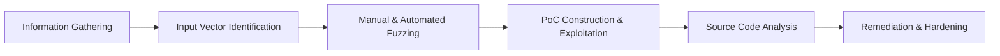

# 🛡️ Damn Vulnerable Web Application (DVWA) – Security Analysis & Write-Ups

A structured collection of in-depth web application security write-ups, vulnerability analyses, Proof-of-Concepts (PoCs), and source code defense reviews conducted across all difficulty levels (**Low**, **Medium**, **High**) of the **Damn Vulnerable Web Application (DVWA)**, including post-exploitation techniques.

---

## ⚠️ Legal and Educational Disclaimer

> [!CAUTION]
> **FOR EDUCATIONAL, RESEARCH, AND DEFENSIVE PURPOSES ONLY**
> 
> The information, methodologies, scripts, and payloads contained in this repository are published strictly for educational purposes, authorized security testing, and defensive engineering. All testing and exploitation documented herein was conducted in an isolated, private local laboratory environment running deliberately vulnerable software.
> 
> Unauthorized testing, scanning, or exploitation of computer systems without explicit, prior written consent from the target asset owner is strictly illegal under the Computer Fraud and Abuse Act (CFAA), the Information Technology Act (India, 2000), and other equivalent international cyber laws. The author assumes no responsibility or liability for any misuse, damage, or unlawful actions committed using the information provided in this repository.

---

## 📌 Repository Overview

This repository documents hands-on security research and penetration testing methodologies across **17 core web application security domains**. Each write-up is formatted as an enterprise-grade assessment report detailing:
- Vulnerability description and root-cause analysis
- Vulnerable vs. secure source code analysis (PHP / SQL / JavaScript)
- Step-by-step reproduction and Proof-of-Concept across multiple security tiers
- Attack automation, payloads, and parameter fuzzing
- Industry-standard remediation guidelines aligned with OWASP & CWE

---

## 📂 Laboratory Write-Up Matrix

| Write-Up File | Vulnerability Focus | OWASP Top 10 (2021) | Difficulty Levels | Primary Tools Utilized |
| :--- | :--- | :--- | :--- | :--- |
| [`2026_08_20_SQL_Injection.md`](2026_08_20_SQL_Injection.md) | **SQL Injection (Classic SQLi)** | `A03:2021` – Injection | Low, Medium, High | Burp Suite, SQLMap, John the Ripper, hashid |
| [`2026_08_22_XSS_Reflected.md`](2026_08_22_XSS_Reflected.md) | **Cross-Site Scripting (Reflected)** | `A03:2021` – Injection | Low, Medium, High | Burp Suite, Browser DevTools, CyberChef |
| [`2026_08_24_XSS_Stored.md`](2026_08_24_XSS_Stored.md) | **Cross-Site Scripting (Stored)** | `A03:2021` – Injection | Low, Medium, High | Burp Suite, Browser DevTools |
| [`2026_08_26_Command_Injection.md`](2026_08_26_Command_Injection.md) | **OS Command Injection** | `A03:2021` – Injection | Low, Medium, High | Burp Suite, Netcat, Linux CLI |
| [`2026_08_28_File_Upload.md`](2026_08_28_File_Upload.md) | **Unrestricted File Upload** | `A04:2021` – Insecure Design | Low, Medium, High | Burp Suite, Weevely/PHP Web Shells |
| [`2026_08_30_CSRF.md`](2026_08_30_CSRF.md) | **Cross-Site Request Forgery** | `A01:2021` – Broken Access Control | Low, Medium, High | Burp Suite CSRF PoC Generator |
| [`2026_09_01_Brute_Force.md`](2026_09_01_Brute_Force.md) | **Authentication Brute Force** | `A07:2021` – Auth Failures | Low, Medium, High | Hydra, Burp Intruder, SecLists |
| [`2026_09_03_File_Inclusion.md`](2026_09_03_File_Inclusion.md) | **File Inclusion (LFI / RFI)** | `A03:2021` – Injection | Low, Medium, High | Burp Suite, Python HTTP Server |
| [`2026_09_05_SQL_Injection_Blind.md`](2026_09_05_SQL_Injection_Blind.md) | **Blind SQL Injection (Boolean / Time)** | `A03:2021` – Injection | Low, Medium, High | Burp Suite, SQLMap, Custom Scripts |
| [`2026_09_07_XSS_DOM.md`](2026_09_07_XSS_DOM.md) | **Cross-Site Scripting (DOM-based)** | `A03:2021` – Injection | Low, Medium, High | Browser DevTools, JavaScript Console |
| [`2026_09_09_Weak_Session_IDs.md`](2026_09_09_Weak_Session_IDs.md) | **Predictable Session Identifiers** | `A07:2021` – Auth Failures | Low, Medium, High | Burp Sequencer, Hashcat, CyberChef |
| [`2026_09_11_Insecure_CAPTCHA.md`](2026_09_11_Insecure_CAPTCHA.md) | **Broken CAPTCHA / Logic Bypass** | `A07:2021` – Auth Failures | Low, Medium, High | Burp Suite (Repeater & Interceptor) |
| [`2026_09_13_JavaScript_Attacks.md`](2026_09_13_JavaScript_Attacks.md) | **Client-Side Obfuscation & Logic Flaws** | `A02:2021` – Cryptographic Failures | Low, Medium, High | Browser DevTools, de4js, Node.js |
| [`2026_09_15_Open_Redirect.md`](2026_09_15_Open_Redirect.md) | **Unvalidated URL Redirection** | `A01:2021` – Broken Access Control | Low, Medium, High | Burp Suite, URL Fuzzing |
| [`2026_09_17_CSP_Bypass.md`](2026_09_17_CSP_Bypass.md) | **Content Security Policy (CSP) Bypass** | `A05:2021` – Security Misconfiguration | Low, Medium, High | Browser DevTools, External Scripts |
| [`2026_09_19_Authorisation_Bypass.md`](2026_09_19_Authorisation_Bypass.md) | **Broken Authorization (IDOR)** | `A01:2021` – Broken Access Control | Low, Medium, High | Burp Suite, Cookie / Token Manipulation |
| [`2026_09_21_Password_Cracking.md`](2026_09_21_Password_Cracking.md) | **Cryptographic Hash Analysis & Cracking** | `A02:2021` – Cryptographic Failures | Post-Exploitation | John the Ripper, Hashcat, SecLists |

---

## 🔬 Vulnerability Domain Deep Dives

### 1. Injections (`A03:2021`)
- **SQL Injection (In-Band & Blind):** Exploitation of unfiltered inputs in database querying routines. Low difficulty bypasses simple string concatenation (`' OR 1=1 -- -`), Medium addresses integer casting flaws using Burp Repeater parameter alteration, and High investigates out-of-band/session-based inputs and blind boolean/time differentials.
- **Command Injection:** Analysis of shell execution wrappers (`shell_exec`, `passthru`). Demonstrates chaining commands via delimiters (`;`, `&&`, `|`), bypassing basic blacklist filters, and securing processes using input whitelisting or escaping via `escapeshellcmd` / `escapeshellarg`.
- **File Inclusion (LFI / RFI):** Exploits dynamic path construction in `include()` / `require()`. Demonstrates directory traversal sequences (`../../../../etc/passwd`), null-byte injection nuances, PHP stream wrappers (`php://filter`), and remote payload inclusion.

### 2. Cross-Site Scripting (XSS)
- **Reflected & Stored XSS:** Injecting client-side execution vectors into web applications. Explores character escaping bypasses (`<script>` replacement case-sensitivity, nested tags `<scr<script>ipt>`, event handlers `onload`/`onerror`).
- **DOM-Based XSS:** Analysis of client-side JavaScript execution sinks (`document.write`, `innerHTML`, `location.href`) consuming untrusted sources (`location.search`, `location.hash`).

### 3. Broken Access Control & Redirection (`A01:2021`)
- **CSRF (Cross-Site Request Forgery):** Forging unauthorized state-changing requests on behalf of authenticated users. Evaluates anti-CSRF token lifecycle, HTTP `Referer` validation bypasses, and defenses including `SameSite` cookie attributes.
- **Insecure Direct Object References (IDOR):** Horizontal and vertical privilege escalation by altering object identifiers in requests without proper server-side session-to-object ownership validation.
- **Open Redirection:** Exploitation of unvalidated redirect endpoints used in phishing delivery chains; remediation through strict origin whitelists.

### 4. Authentication, Session & Logic Flaws (`A07:2021`, `A02:2021`)
- **Brute Force & Rate Limiting:** Automating credential attacks, assessing lockout thresholds, and mitigating through exponential backoff, account lockouts, and multi-factor authentication (MFA).
- **Weak Session IDs:** Entropy analysis using Burp Sequencer. Demonstrates the risks of sequential IDs, predictable timestamps, and MD5-hashed incrementing counters.
- **Insecure CAPTCHA:** Logic analysis of multi-step verification workflows. Bypasses client-controlled parameters (`step=2` / `passed_captcha=true`) where the server fails to enforce state integrity.
- **JavaScript Analysis & Obfuscation:** Reverse engineering client-side hashing, obfuscated logic routines, and understanding why security controls must never rely exclusively on client-side constraints.
- **Password Cracking:** Post-exploitation forensic analysis identifying hash algorithms (MD5, SHA-1, Bcrypt), salt inspection, dictionary attacks, and rule-based cracking with RockYou / SecLists.

---

## 🛠️ Tooling & Methodology

The security reviews followed the **OWASP Web Security Testing Guide (WSTG v4.2)** methodology:

- **Interception & Analysis:** Burp Suite Professional / Community Edition (Proxy, Repeater, Intruder, Sequencer)
- **Automation & Exploitation:** SQLMap, Hydra, Netcat, Python Custom Scripts
- **Password & Hash Analysis:** John the Ripper, Hashcat, hashid, CyberChef
- **Client & DOM Inspection:** Chromium Developer Tools, de4js, Node.js

---

## 🔒 Recommended Defensive Hardening

1. **Parameterized Queries:** Use prepared statements and parameterized queries (e.g., PHP PDO) for all database operations to neutralize SQL Injection.
2. **Context-Aware Output Encoding:** Apply context-sensitive escaping (HTML, Attribute, JavaScript) and leverage secure modern frameworks with built-in templating sanitization.
3. **Strict Content Security Policy (CSP):** Deploy strict CSP policies (`script-src 'self' 'nonce-...'`) to mitigate script injection and unauthorized resource loading.
4. **Server-Side Authorization & Token Validation:** Verify session permissions for every discrete resource access (combating IDOR) and enforce nonces/anti-CSRF tokens for all state-changing requests.
5. **Secure Cryptographic Primitives:** Generate high-entropy session tokens using cryptographically secure pseudo-random number generators (CSPRNG) and use modern password hashing algorithms (Argon2id, Bcrypt).

---

## 👤 Author & Lab Details

- **Author:** Adinath Dubile ([@adinathgorakhdubile](https://github.com/adinathgorakhdubile))
- **Primary Lab Environment:** Damn Vulnerable Web Application (DVWA)
- **Operating Environment:** Kali Linux / Dedicated Penetration Testing Lab
